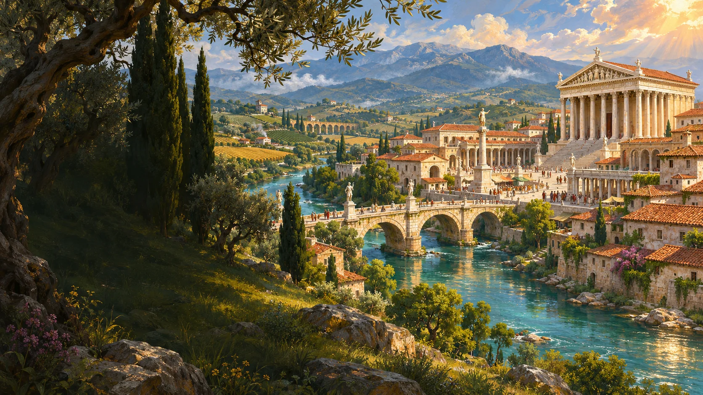
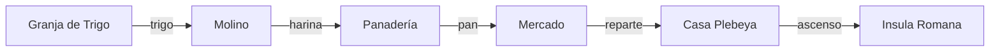

<div align="center">



# 🏛️ Aurea Pax — Constructor Romano

**Traza calzadas, abastece los mercados y convierte una pequeña colonia en una próspera ciudad romana.**

[](https://github.com/guillermo259/Aurea-Pax/actions/workflows/ci.yml)
[](https://github.com/guillermo259/Aurea-Pax/actions/workflows/deploy-pages.yml)


### ▶️ [Jugar en el navegador](https://guillermo259.github.io/Aurea-Pax/)

</div>

Aurea Pax es un juego de construcción y logística en vista isométrica 2D. Conectas edificios con calzadas, mantienes la economía en marcha y buscas la **Laurea del Senado**. Todo corre en el navegador, sin servidor ni variables de entorno.

## ✨ Características

| Función | Qué ocurre en la partida |
|---|---|
| 🛣️ **Logística con carretas** | Carretas y ciudadanos recorren tus calzadas. Un taller sin calzada no recibe materia prima. |
| 🌾 **Cadenas de producción** | Trigo → harina → pan, uva → vino, arcilla → cerámica, además de madera y piedra. |
| 🏛️ **Una ciudad que crece** | Puedes ascender una Casa Plebeya a Insula Romana si tiene calzada, Fuente, Mercado y pan. |
| 🔥 **Crisis que atender** | Incendios (la brigada cuesta denarios, y un fuego sin apagar destruye el edificio), escasez de pan prolongada que mata habitantes, calzadas cortadas y bancarrota. |
| 🌦️ **Clima y día y noche** | La lluvia sube un 12 % el rendimiento de las granjas y el viento lo baja un 10 %. Un día dura 600 segundos de simulación. |
| 🌫️ **Niebla de guerra** | No puedes construir en terreno inexplorado. Las calzadas y las Torres de Vigía despejan la niebla. |
| ⏳ **Recursos finitos** | Bosques, canteras y vetas se agotan y dejan el terreno baldío. |
| 🗺️ **Mapas por semilla** | Cada semilla (de 0 a 4 294 967 295) genera un relieve, una costa y unos lagos propios. El mismo número produce el mismo mapa. |
| 💾 **Guardado con copia de seguridad** | Autoguardado cada 25 segundos, copia de seguridad y exportar o importar partidas en JSON con validación. |
| 🔊 **Sonido sintetizado** | Los efectos se generan con Web Audio API. El proyecto no incluye archivos de audio. |

## 🎯 Cómo se juega

1. **Conecta la colonia.** Une viviendas y talleres con calzadas hasta el Horreum, tu almacén, para que las carretas circulen.
2. **Produce pan.** Lleva el trigo al Molino y la harina a la Panadería. El Mercado reparte el pan a las viviendas cercanas.
3. **Revisa tus objetivos.** El panel de objetivos muestra qué le falta a la colonia. El libro de cuentas muestra existencias y gastos.



El ascenso exige calzada, Fuente, Mercado y pan.

## 🏆 Objetivos del Senado

| Objetivo | Cómo se consigue |
|---|---|
| Pan en la mesa | Construye Granja de Trigo, Molino y Panadería, y conecta cada taller con calzada |
| Primera cosecha | Siembra una Granja de Trigo y deja que madure |
| 40 habitantes | Amplía Casas Plebeyas junto a calzada, Fuente y Mercado |
| Una Insula de Cives | Asciende una Casa Plebeya con calzada, Fuente, Mercado y pan |
| Un Templo | Los Cives exigen un Templo o un Foro a menos de 9 casillas de su vivienda |
| El Foro Romano | Construye el Foro y conéctalo a la calzada |
| Explorar la isla | Despeja el 30 % del mapa |
| **Laurea del Senado** | 150 habitantes, 60 Cives, Foro y balance de denarios positivo |

## 🏗️ Edificios y bienes

| Categoría | Edificios (tecla) |
|---|---|
| Logística | Calzada (1), Horreum (2), Mercado (3) |
| Cívico | Casa Plebeya (4), Fuente (5), Templo (6), Foro Romano (7), Torre de Vigía, Insula Romana (por ascenso) |
| Alimentos | Granja de Trigo (8), Molino (9), Panadería (0), Viñedo, Lagar |
| Industria | Leñador, Cantera, Pozo de Arcilla, Alfarería |

Bienes: madera, piedra, trigo, harina, pan, uva, vino, arcilla y cerámica.

## ⌨️ Controles

| Acción | Tecla |
|---|---|
| Mover la cámara | <kbd>W</kbd> <kbd>A</kbd> <kbd>S</kbd> <kbd>D</kbd> o flechas |
| Acercar y alejar | <kbd>+</kbd> / <kbd>−</kbd> |
| Centrar la vista | <kbd>C</kbd> |
| Pausar o reanudar | <kbd>Espacio</kbd> |
| Cambiar velocidad (1×, 2×, 3×) | <kbd>V</kbd> |
| Abrir o cerrar el menú de pausa | <kbd>Esc</kbd> / <kbd>P</kbd> |
| Guardar partida | <kbd>G</kbd> o <kbd>Ctrl</kbd> + <kbd>S</kbd> / <kbd>⌘</kbd> + <kbd>S</kbd> |
| Objetivos · Libro de cuentas | <kbd>O</kbd> · <kbd>B</kbd> |
| Silenciar sonido | <kbd>M</kbd> |
| Guía | <kbd>H</kbd> |
| Cambiar categoría · Siguiente construcción | <kbd>F</kbd> · <kbd>E</kbd> |
| Elegir edificio | <kbd>1</kbd> a <kbd>9</kbd> y <kbd>0</kbd>, según la tabla de edificios |
| Inspeccionar · Ascender vivienda · Demoler | <kbd>Q</kbd> · <kbd>U</kbd> · <kbd>X</kbd> |

## 🚀 Instalación

Necesitas **Node.js 22**, la versión que usa el CI.

```bash
git clone https://github.com/guillermo259/Aurea-Pax.git
cd Aurea-Pax
npm ci
npm run dev
```

Abre **http://127.0.0.1:3000** en el navegador.

Para generar la versión de producción:

```bash
npm run build     # genera dist/, lista para cualquier servidor de archivos estáticos
npm run preview   # sirve el build para revisarlo
```

## 🧪 Calidad y CI

```bash
npm run lint      # comprobación de tipos con tsc --noEmit
npm test          # pruebas de reglas del juego con node:test
```

El workflow **CI** ejecuta `tsc --noEmit`, `npm test` y `npm run build` en cada push a `main` y `remoto`, y en cada pull request.

## 🧱 Arquitectura

```text
src/
├── App.tsx                 # Interfaz principal, bucle de juego y atajos
├── components/             # HUD, paneles y modales en React
└── game/
    ├── simulation.ts       # Reglas y avance de la simulación
    ├── catalog.ts          # Edificios, bienes, costes y cadenas de producción
    ├── mapGen.ts           # Mapa generado a partir de una semilla
    ├── isoRenderer.ts      # Render isométrico en canvas 2D
    ├── pathfinding.ts      # Rutas entre edificios por la red de calzadas (BFS)
    ├── persistence.ts      # Guardado, copia de seguridad e importación validada
    ├── dayCycle.ts         # Ciclo de día y noche
    ├── weatherParticles.ts # Partículas de lluvia y viento
    ├── audio.ts            # Sonidos generados con Web Audio API
    └── rules.test.ts       # Pruebas de reglas del juego
```

| Capa | Tecnología |
|---|---|
| Interfaz | React 19, Tailwind CSS 4, iconos de Lucide y HugeIcons |
| Mapa | Canvas 2D con vista isométrica |
| Sonido | Web Audio API |
| Build y tipos | Vite 8, TypeScript |
| Pruebas | node:test con tsx |

## 🚢 Despliegue

Cada push a `main` ejecuta el workflow de GitHub Pages. Compila con `--base=/Aurea-Pax/` y publica la versión en [guillermo259.github.io/Aurea-Pax](https://guillermo259.github.io/Aurea-Pax/). Cualquier servidor de archivos estáticos que sirva la carpeta `dist/` también funciona.

## 🤝 Contribuir

Abre un issue o un pull request. Antes de enviarlo, ejecuta `npm run lint` y `npm test`.

## 🙏 Inspiración

Aurea Pax se inspira en *Anno 117: Pax Romana*. Es un proyecto independiente, sin relación con Ubisoft.
